# DeltaNav: what changed in the room?

**Visibility-verified 3D change detection for robot navigation, from two phone videos.** *Delta* is the
change, *Nav* is what a robot does with it.

Give it two phone videos of the same room, one before and one after you move things around. It builds one
metric 3D model of the room from both, finds what moved, appeared or disappeared, and reports where (room
coordinates with error bars), how far, how much it turned, and what it is, in plain English. It then edits a
robot's map with the verified changes, re-plans its routes, and says why each route changed. Wherever the
second video never really looked, it says _could not be checked_ instead of guessing, and plans where to look
next.

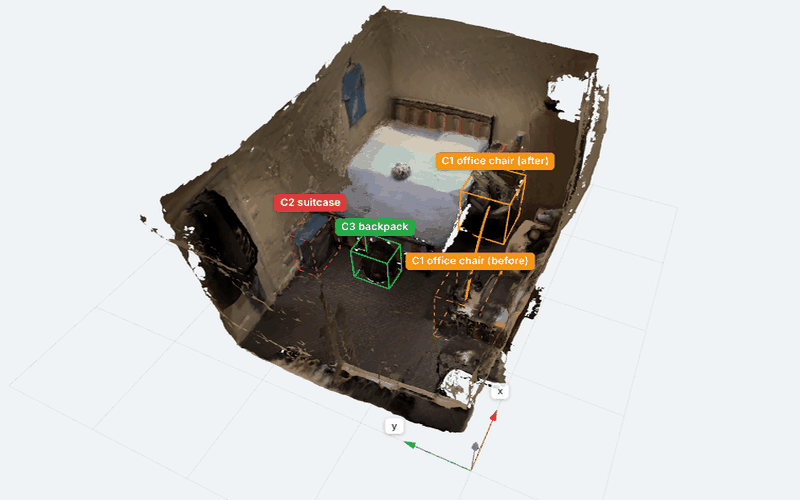

**Click below to open the 3D viewer and change report of my room:**

**[Open the 3D viewer](https://anspermiranda.github.io/deltanav/)** (in the browser, no install) ·

**[Open the 3D window in Rerun](https://app.rerun.io/version/0.39.0/?url=https://anspermiranda.github.io/deltanav/scene.rrd)** ·

**[Full report for my room](https://anspermiranda.github.io/deltanav/report.html)** ([markdown](examples/my_room/report.md)) ·
[design note](DESIGN.md) · **[run it on your own room](#run-it-on-your-own-room)**

---

##

- **Input:** two ordinary phone videos. No depth sensor, no markers, different walking paths.
- **Shared 3D:** both videos go into *one* reconstruction, so they share a coordinate frame from the start.
  Metric depth is fused into coloured 3D surfaces: one per video, plus a *shared* room model with each changed
  object shown in both versions. Every number is in a **room frame** (origin on the floor in a corner, x and y
  along the walls, z up, metres).
- **Change detection that is not fooled by viewpoint, occlusion or missing coverage.** A thing counts as
  gone only if the other video's cameras looked *through* the place where it was. Hidden or unfilmed places
  are reported as *could not be checked*, with the reason.
- **Semantics + numbers:** each change gets a name and colour, its pose before and after (± 1 sigma), the
  distance moved, the rotation and where it comes from, a 4×4 transform, its size, its relations to the
  furniture, a sentence, and the evidence behind it.
- **For a robot:** the verified changes are applied to yesterday's map as edits; routes are re-planned for a
  humanoid and for a compact robot, with the cause of every route change; 2D maps for ROS 2 / Nav2, named goal
  poses and a 3D occupancy grid are exported; and the planner proposes **where to look next**.
- **To look at:** a 3D viewer that opens in any browser (Shared / Before / After / Blink, layers, a card per
  change; it works offline), a video of the 3D model, the same scene in a Rerun window with a timeline through
  both videos, annotated videos and a report page, all written by every run, for any room.

## Result on my bedroom

I filmed my room on an iPhone (0.5× ultra-wide lens, about 9 minutes per video, one lap at chest height and
one at waist height), made three changes, and filmed it again. The pipeline was given only the two video
files.

| What I did | What the pipeline reports (verbatim) | Room frame (m, ± 1σ) |
|---|---|---|
| Moved the office chair from the desk into the gap between the bed and the wardrobe, in front of the bedside table, turned towards the wardrobe | *The black office chair moved 1.4 m, from the desk to between the bed and the wardrobe, and turned about 55°.* | (1.31, 0.61) → (2.65, 0.86): 1.36 ± 0.04 m, turned +57° (377 of 844 matched features agree) |
| Took the blue suitcase out of the room | *The blue suitcase at the foot of the bed, against the wall, is gone: 48 frames of the after video look straight through the space it filled.* | was at (1.43, 2.25) ± 0.03, 0.61 m tall |
| Put a backpack on the floor in front of the bed's footboard | *A black backpack (0.47 m tall) appeared at the foot of the bed. It stands on the floor, so it is a new obstacle.* | (1.52, 1.62) ± 0.02, 0.47 m tall |

That is **3 of 3 changes, with the right names, colours and places, and no false changes.** Nothing else in
the room was reported, although the two recordings follow different paths and 12% of the surfaces could not
be re-checked. All 360 keyframes (180 per video) went into one 3D model.

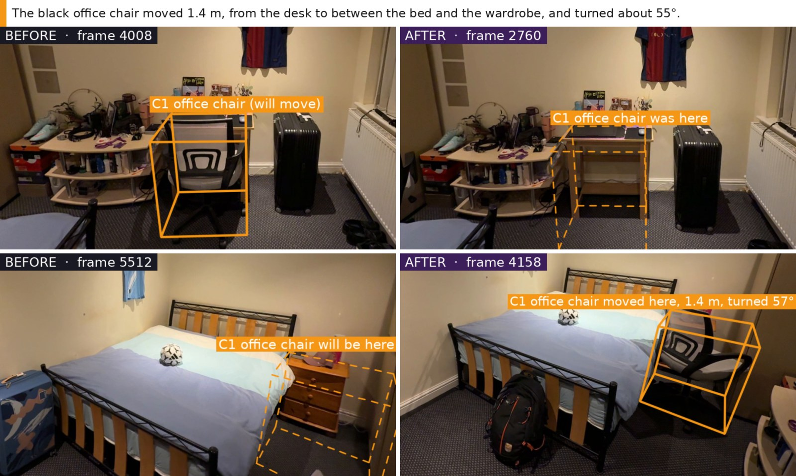
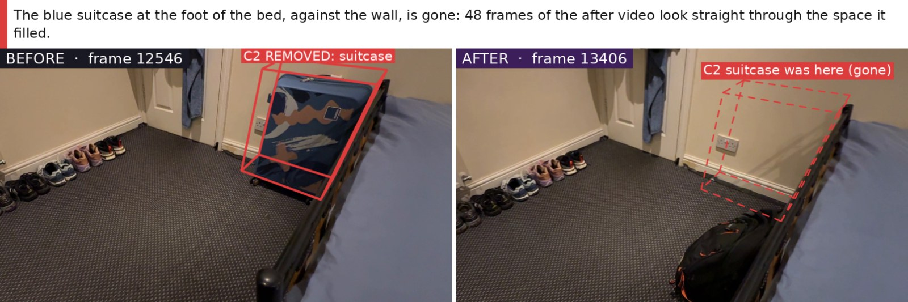
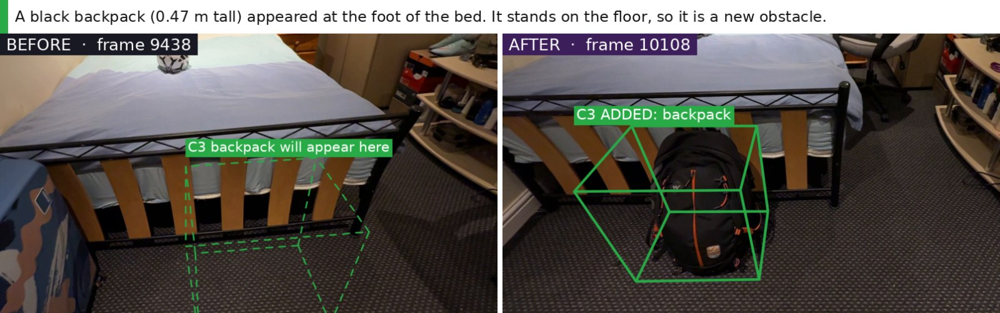

<sub>Each pair is a real frame from each video with the same 3D box projected into it, chosen automatically
from frames that look at the same place. The boxes come from the 3D result and are not drawn by hand. Solid:
the object is there in that video. Dashed: the place is empty in that video.</sub>

| The shared 3D model, with every change | The floor plan (room frame, metres) |
|---|---|
| 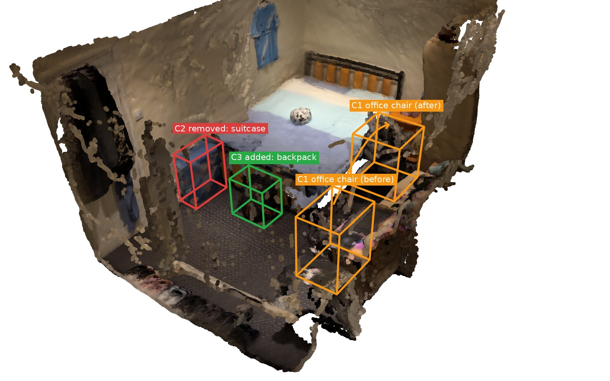 | 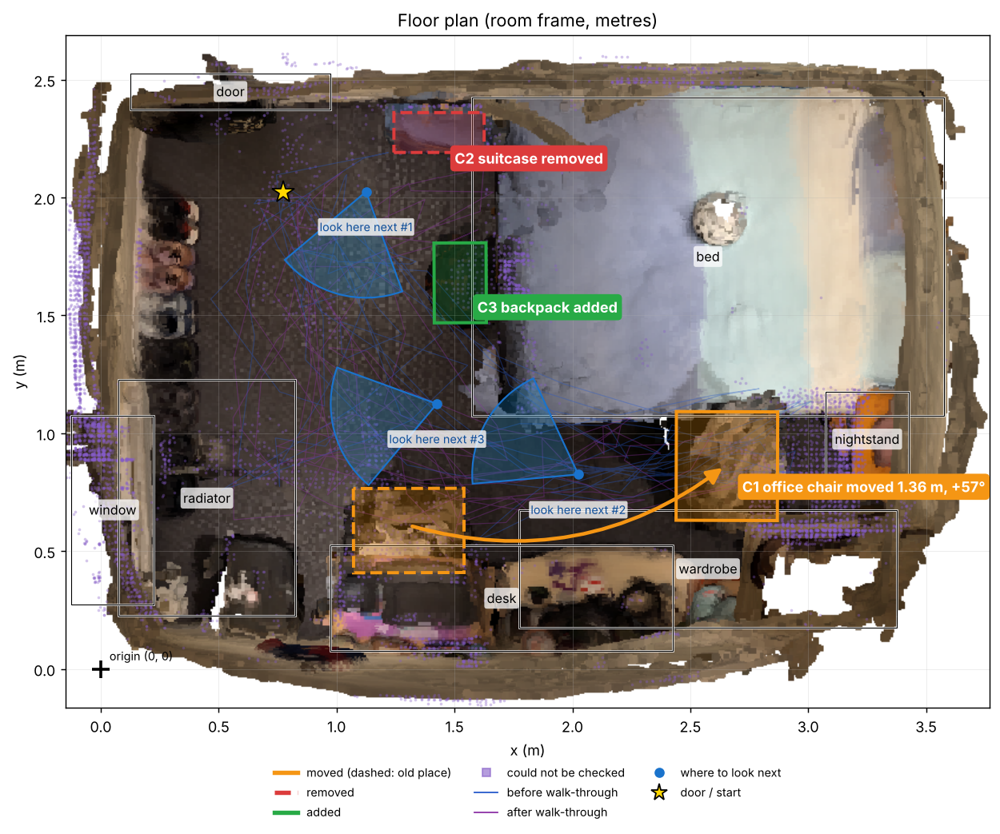 |

| Before video only (3D) | After video only (3D) |
|---|---|
| 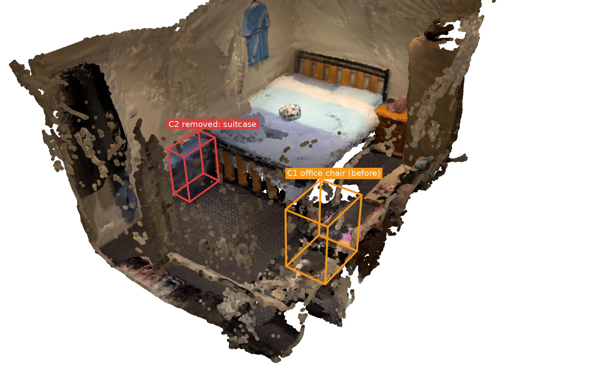 | 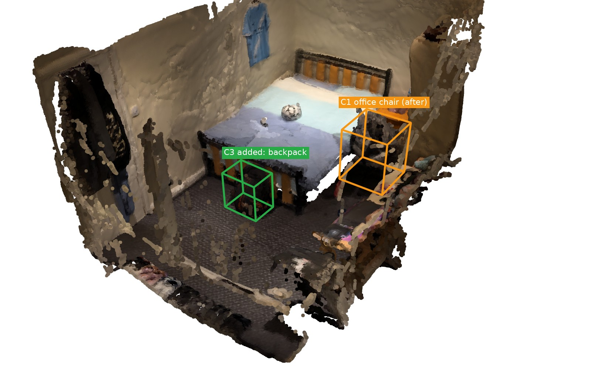 |

Every change is also a record in [`ledger.json`](examples/my_room/ledger.json), in the room frame:

```json
{"id": "C1", "type": "moved", "label": "office chair", "colour": "black",
 "before": {"x": 1.309, "y": 0.609, "z": 0.413, "sigma_m": 0.023, "orientation_deg": 0.2,
            "size_m": {"length": 0.47, "width": 0.36, "height": 0.69},
            "relations": [{"relation": "at", "target": "desk"}, {"relation": "on", "target": "floor"}]},
 "after":  {"x": 2.647, "y": 0.861, "z": 0.435, "sigma_m": 0.028, "orientation_deg": 89.8,
            "relations": [{"relation": "between", "target": "bed and wardrobe"}, {"relation": "on", "target": "floor"}]},
 "delta":  {"dx": 1.338, "dy": 0.252, "dz": 0.022, "distance_m": 1.361, "distance_sigma_m": 0.036,
            "rotation_deg": 57.4, "rotation_source": "appearance (SIFT matches lifted to 3D, RANSAC)",
            "rotation_confident": true, "rotation_support": {"inliers": 377, "matches": 844},
            "transform_before_to_after": [[0.539, -0.842, 0, ...], ...]},
 "evidence": {"old_place": {"views_saw_through": 59, "views_saw_surface": 0},
              "new_place": {"views_saw_through": 64, "views_saw_surface": 0}}}
```

## What one run gives you

`deltanav run --before A.mov --after B.mov --out outputs/my_room` writes all of this, prints the changes,
and opens the 3D viewer and the report at the end (`deltanav view outputs/my_room` opens them again):

| | |
|---|---|
| **`viewer.html`, the 3D viewer**: one file that opens in any browser, offline, or as a link on GitHub Pages. Rotate, pan and zoom with the mouse; switch between Shared, Before, After and Blink (before and after alternate, like a blink comparator); turn layers on and off (room surfaces, change boxes and arrows, could-not-be-checked, see-through evidence, furniture, robot map and routes per robot, where to look next, camera paths, axes); click a change card to fly to it. | 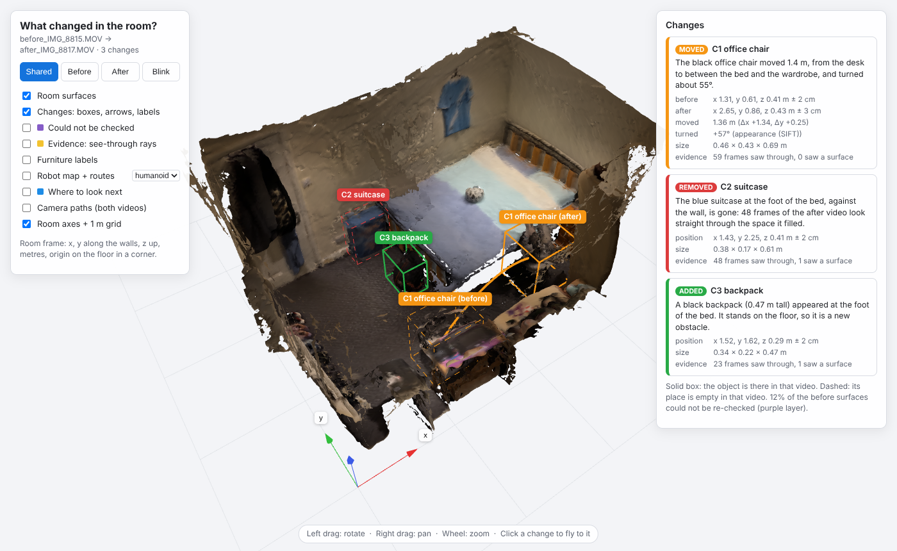 |
| **`scene.rrd`, the Rerun window** (`deltanav view outputs/my_room --rerun`, [Rerun](https://rerun.io)): the same scene for robotics tooling. Switch the shared model, the before-only and after-only surfaces, the changed objects, the evidence rays, the places that could not be checked, the robot maps, routes and 3D occupancy on and off (eye icons on the left). Scrub the timeline to walk through both videos, with the annotated frame in each camera. | |
| **`report.html`**: one self-contained page with every change (sentence, numbers, evidence, before/after frames), the 3D renders, the floor plan, the robot section, where to look next, and what could not be checked. | 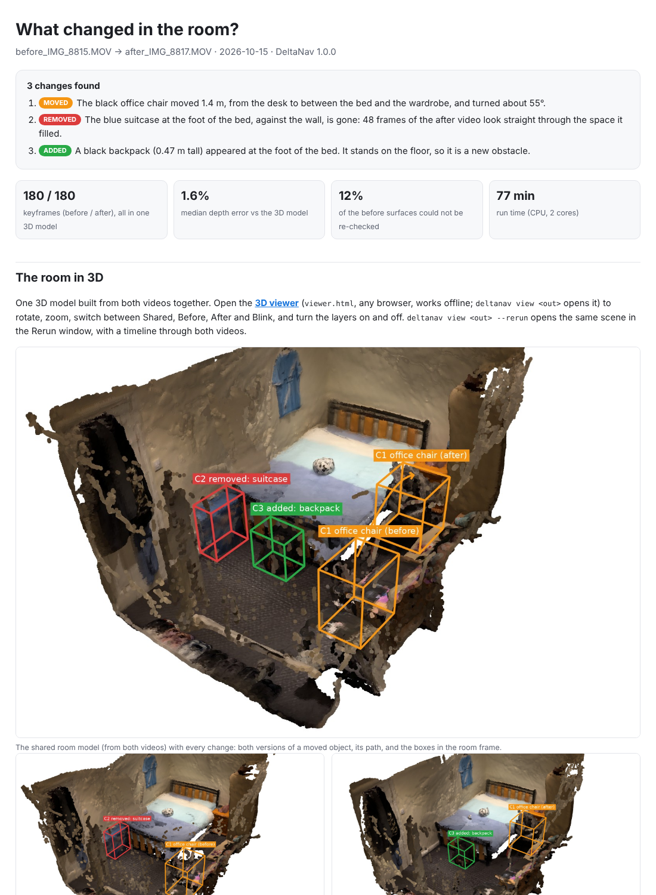 |
| **`video/3d_model.mp4`**: a 10-second video of the 3D reconstruction, half an orbit around the shared model with every change boxed, then the before-only and after-only models alternating ([mine](https://anspermiranda.github.io/deltanav/video/3d_model.mp4)). | |
| **`video/before_annotated.mp4`, `video/after_annotated.mp4`**: every keyframe of each walk-through with the changed objects boxed and labelled, including where something *will* appear or *was*, and "(hidden)" when something nearer is in the way. | 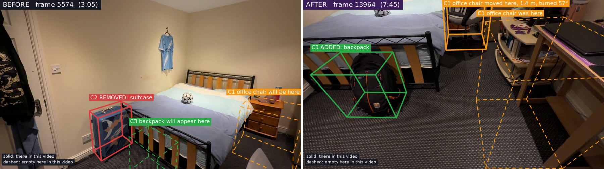 |
| **`ledger.json`**: one record per change in the room frame (above), plus the furniture, what could not be checked and why, the rejected candidates, and the suggested next views. | |
| **`maps/`**: 2D occupancy maps (before, updated, after) in ROS `map_server` format for each robot, named **goal poses** (`<robot>_goals.yaml`), the routes (`routes.json`, including a route to go and check each change), and a **3D occupancy grid** (`occupancy3d.npz`, free / occupied / unknown at 4.5 cm). | 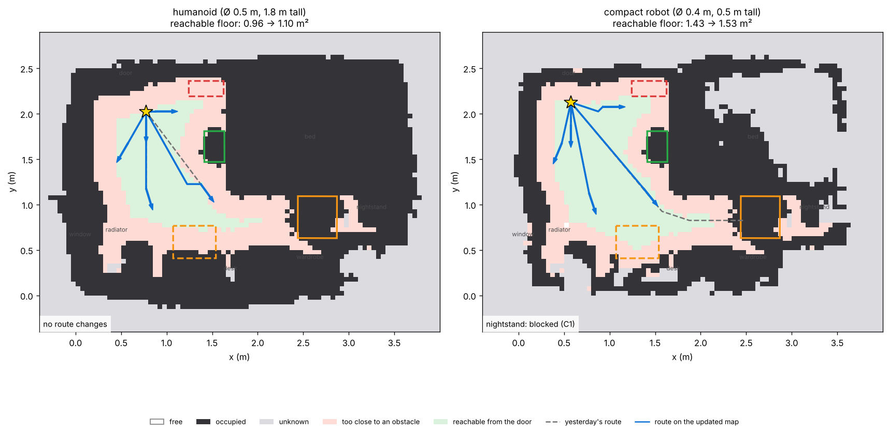 |
| **`meshes/*.ply`**: coloured surfaces (shared room, before, after, each changed object in each version). They open in MeshLab, Blender or CloudCompare. | |

## The idea: absence of evidence is not evidence of absence

The obvious approach is to reconstruct the room twice and diff the two point clouds. It fails because the two
recordings never see exactly the same surfaces. Anything hidden behind furniture, or simply not filmed the
second time, has "no matching point" and gets reported as removed.

So this pipeline never asks *is there a matching point?* It asks *did the other video look through this
place, and what did it see?* Every surface point from one video is projected into every frame of the other
video and compared with that frame's metric depth:

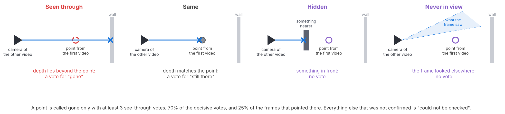

On top of the per-point test, each candidate object gets a **frame-level verdict**: *how many frames of the
other video saw straight through its place, and how many saw a surface there?* Thin or see-through structures
(a mesh chair back, a wardrobe edge seen at a grazing angle) fool a few points but not whole frames, so they
are rejected, and the report lists them with the reason. Both viewers can show this evidence: a yellow ray
from each camera that saw through a changed object's place to the surface behind it.

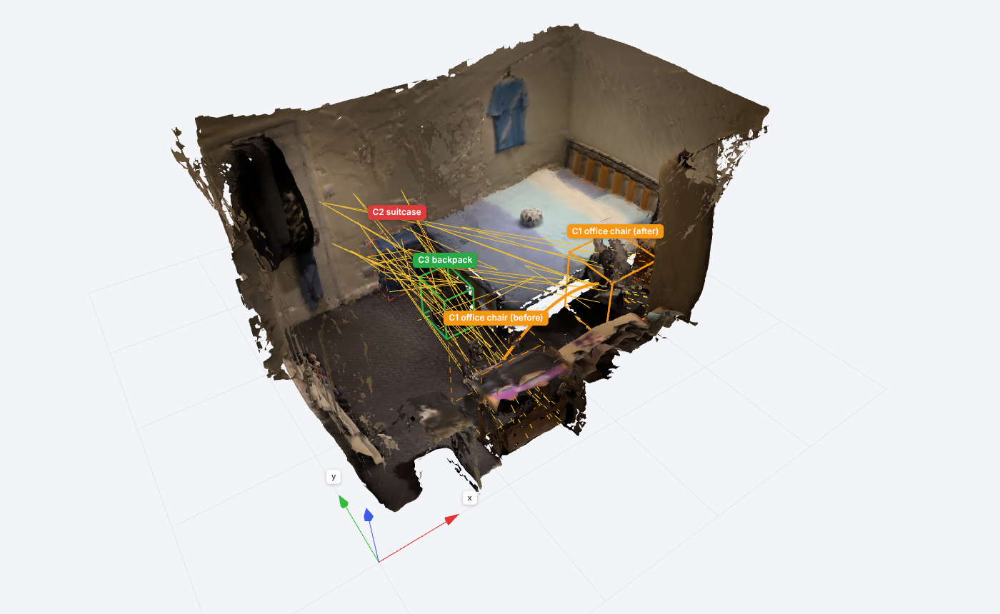

The same data, judged both ways:

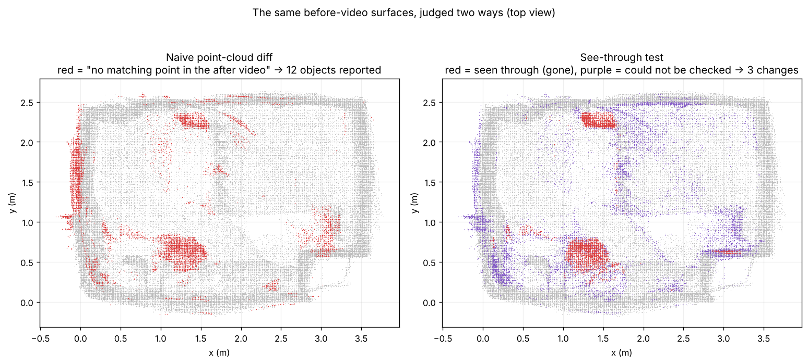

## Spatial AI for navigation

A robot that mapped this room yesterday now has a wrong map. The pipeline turns the **verified** changes into
**map edits**: inside each change's footprint the map takes what the after video saw, and nothing else in the
map moves. So reconstruction noise and the corners the second walk-through skipped never alter the map. In my
room the edits change 0.65 m² of the humanoid's map; rebuilding it from the after video alone would have
changed 1.39 m², most of it depth noise and coverage rather than change.

What counts as an obstacle depends on the robot. The maps are height-aware: a compact robot (Ø 0.4 m, 0.5 m
tall) can drive under the desk, a humanoid (Ø 0.5 m, 1.8 m tall) cannot. For each robot the pipeline plans
routes from the door to a goal pose in front of every piece of furniture (A* on the inflated map), compares
them with yesterday's, and traces every difference back to the change that caused it, by re-planning with
that one edit left out:

- *Compact robot (Ø 0.4 m, 0.5 m tall): The nightstand can no longer be reached: the office chair is in the way.
  Yesterday's route to the nightstand would now run straight into the office chair. Floor it can reach from the
  door: 1.43 m² before, 1.53 m² now.*
- *Humanoid (Ø 0.5 m, 1.8 m tall): Yesterday's route to the wardrobe would pass within 0.22 m of the backpack,
  inside its 0.25 m radius. Floor it can reach from the door: 0.96 m² before, 1.10 m² now.*

The same edits matter differently to the two robots. The chair, now in front of the bedside table, cuts the
compact robot off from it (the humanoid never fitted there), while the backpack only narrows the humanoid's way
to the wardrobe. Taking the chair away from the desk and the suitcase out of the room frees floor for both.
Obstacles lower than 12 cm are ignored: below that, monocular depth cannot tell a low object from a bump in
the floor.

Each robot also gets a **goal pose for inspecting every change** (`check_C3_backpack`, ...), and a **3D
occupancy grid** (free / occupied / unknown in 4.5 cm voxels, `maps/occupancy3d.npz`) for a robot that is not
flat: a humanoid's arms and head need the space above the floor as well.

**Ready for a robot (optional, needs ROS 2).** DeltaNav itself does not use ROS. The two snippets below are
for someone with a robot, or a robot simulator, running ROS 2 and its navigation stack, Nav2. The first loads
the updated map that DeltaNav wrote into Nav2's map server, so the robot plans on today's room instead of
yesterday's. The second reads the goal poses DeltaNav exported, in the same map frame, and sends the robot to
each in turn: in front of each piece of furniture, then to look at each change.

```bash
ros2 run nav2_map_server map_server --ros-args -p yaml_filename:=outputs/my_room/result/maps/humanoid_map_updated.yaml
```

```python
# drive to every goal pose DeltaNav exported: furniture, then each change to check (Nav2 simple commander)
import yaml, math, rclpy
from geometry_msgs.msg import PoseStamped
from nav2_simple_commander.robot_navigator import BasicNavigator
rclpy.init(); nav = BasicNavigator(); nav.waitUntilNav2Active()
goals = yaml.safe_load(open('outputs/my_room/result/maps/humanoid_goals.yaml'))['poses']
poses = []
for g in goals:
    p = PoseStamped(); p.header.frame_id = 'map'; p.header.stamp = nav.get_clock().now().to_msg()
    p.pose.position.x, p.pose.position.y = g['x'], g['y']
    p.pose.orientation.z, p.pose.orientation.w = math.sin(g['yaw'] / 2), math.cos(g['yaw'] / 2)
    poses.append(p)
nav.followWaypoints(poses)
```

**Where to look next.** The surfaces the after video could not verify are where a robot should look next.
Candidate viewpoints on floor the robot can reach are scored by how much of those surfaces they would see with
nothing nearer in the way (a 360° depth panorama of the room as it is now), and the best ones are chosen
greedily. They appear in the report, the floor plan and both 3D viewers ("look here next #1").

**Does looking where the planner says help?** In the verification-loop experiment a robot starts with a
partial look at the room: 25 after-video frames, none of which saw the suitcase's place. It then gets one more
frame at a time from the other 155. The planner picks each next frame from its current model only (it never
sees a frame's image before choosing it), re-checks what is still unknown with the frames it has, and repeats.
It confirmed the suitcase's removal after **8 frames**; in random order it took a median of 13, and in 3 of 10
random orders 30 frames were not enough. After 6 frames the planner had checked 78% of the before-video
surface, against 56% in random order.

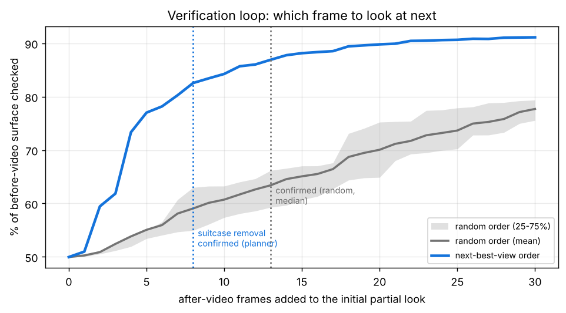

## Does it hold up?

There is no hand-labelled ground truth for every surface, so the tests are built so that the correct answer
follows from how the videos were recorded. Each video has two laps, at chest height and at waist height.
Comparing the two laps of the *same* video is a no-change test with a large change of viewpoint.

| Test | Frames (before / after) | Correct answer | This pipeline | Naive point-cloud diff |
|---|---|---|---|---|
| **No-change control:** before video, chest lap vs waist lap | 101 / 79 | nothing | **nothing** | 3 objects |
| **No-change control:** after video, chest lap vs waist lap | 100 / 80 | nothing | **nothing** | 2 objects |
| **Full comparison** (both laps) | 180 / 180 | 3 changes | **3 changes, 0 false** | 12 objects |
| Before waist lap vs after chest lap | 79 / 100 | 3 changes | **3 changes, 0 false** | 9 objects |
| Before chest lap vs after waist lap | 101 / 80 | 3 changes | chair and suitcase (named "saddlebag"), backpack missed, 0 false | 5 objects |
| **Never filmed:** the 65 after frames that had the suitcase's place in view removed | 180 / 115 | suitcase: can't tell | suitcase points **100% could-not-check**, not reported; chair move still found | 5 objects, suitcase "removed" |
| **Only hidden:** the 49 after frames that actually saw the place removed | 180 / 131 | suitcase: can't tell | suitcase points **100% could-not-check** | 10 objects, suitcase "removed" |

The single-lap comparisons are the hardest case: half the frames, and a large change of viewpoint between the
two recordings. In one of them the backpack is missed (from the before video's chest-height lap alone, too few
frames saw through its spot to call it new) and the suitcase gets an open-vocabulary name, "saddlebag". Both
errors lean the safe way: nothing that did not change is reported. The frame check is what keeps the controls
clean: in each no-change control it rejected one candidate whose place several frames still saw as a surface
(3 of 14 and 6 of 32 frames), and the report lists those rejections with their reasons.

**Synthetic test** (runs in CI, `tests/`). A box room is rendered from two sets of cameras: one cube is
removed, a new cube hides part of the back wall, and the second set of cameras never looks at the left wall.

| Region (synthetic) | gone | same | could not be checked | naive diff says changed |
|---|---|---|---|---|
| removed cube | **72%** | 1% | 27% | 99% |
| wall hidden behind the new cube | **0%** | 23% | 77% | 56% |
| wall never filmed the second time | **0%** | 0% | 100% | 98% |
| walls seen by both | **0%** | 82% | 18% | 11% |

**Is it metric?** Phone video has no scale, so metres come from the depth network, corrected for the
ultra-wide lens (see the [design note](DESIGN.md)). As checks:

- The camera heights come out at 1.36 / 1.28 m on the chest laps and 0.95 / 0.98 m on the waist laps.
- The bed measures 2.00 × 1.35 m with its frame (a UK double mattress is 1.90 × 1.35 m).
- The suitcase is 0.61 m tall and the backpack 0.47 m.
- The median depth error against the reconstruction's 3D points is 1.6% (4.1% before the per-frame correction).
- The chair's rotation comes from 377 of 844 matched visual features that agree on +57°. The geometry-only
  estimate is ambiguous for a chair (+36°, and flagged as uncertain), which is why appearance decides.

## How it works

```
before.mov ─┐                                                              ┌─ changes + ledger (room frame, ± error)
            ├─ sharp keyframes ─ ONE joint 3D reconstruction ─ metric depth ┤─ meshes, 3D window, viewer, report, videos
after.mov ──┘                     (both videos, SfM)            per frame    └─ robot maps, routes + causes, look-here-next
                                                                  │
                     see-through test (both directions) ─ objects ─ names, colours ─ moves, rotation ─ words
```

1. **Keyframes.** About 180 sharp frames per video (Laplacian sharpness, with a penalty for motion blur).
2. **One reconstruction for both videos.** Keyframes from both videos go into a single structure-from-motion
   problem (COLMAP via `pycolmap`: SIFT, sequential + vocabulary-tree matching, global mapper), so the
   unchanged room ties them together and no alignment step is needed. **Room frame:** gravity from the camera
   axes, x and y along the walls, origin on the floor in a corner.
3. **Metric depth.** Depth Anything V2 (metric, indoor) on every keyframe, with a correction for the lens and
   a smooth per-frame correction fitted to the reconstruction's 3D points. A pixel is kept only if
   neighbouring frames confirm it.
4. **Surfaces.** TSDF fusion and marching cubes give a coloured mesh per video and a shared one built from
   both videos with the changed objects cut out.
5. **See-through test** in both directions, with self-consistency gating and the frame-level verdict.
6. **Objects and names.** Clusters of changed points become objects. Names come from voting over instance
   masks: YOLO11-seg for COCO classes, YOLOE for an open vocabulary; a name must fit the measured size.
   Colours come from white-balanced pixels.
7. **Moves and rotation.** Removed and added objects are paired on name, size and colour. The rotation comes
   from SIFT matches on the object lifted to 3D, then RANSAC; a geometry-only estimate is the fallback, and it
   is flagged when ambiguous.
8. **Words.** Sentences and relations ("at the desk", "between the bed and the wardrobe", "at the foot of the
   bed") are generated from the structured result and from furniture lifted to 3D, so the text and the
   geometry cannot disagree.
9. **Robot.** Map edits, height-aware occupancy per robot, A* routes with counterfactual causes, goal poses,
   3D occupancy, next-best views, and ROS export.

**What is new here, and what is not.** Reasoning about free space along camera rays is an established idea in
robot mapping (Khronos and Panoptic Multi-TSDFs use it for changing scenes). DeltaNav's contribution is the
whole chain, built for a robot that comes back to a room:
- two ordinary phone videos (no depth sensor, no markers) go into one shared metric 3D model;
- the see-through test runs in both directions, and *could not be checked* is a first-class answer;
- verified changes become map edits rather than a re-map, with the cause of every route change;
- the next views are planned to check what is still unknown, and closing that loop is measured.

Choices, alternatives, what did not work, and related work (Khronos, Panoptic Multi-TSDFs, 3DGS-CD, RIO, ...):
**[DESIGN.md](DESIGN.md)**.

## Run it on your own room

Everything shown above for my bedroom is produced for **any two videos you give it**: your room, a lab, an
office. The 3D reconstruction, the detected changes with names and positions, the annotated videos, a video of
the 3D model, the robot maps and routes, and the report. Nothing has to be configured for a new place.

### 1. What you need

| | |
|---|---|
| Computer | Linux, macOS or Windows. Tested on Ubuntu (Python 3.13, 2 CPU cores, 7 GB RAM, no GPU). On Windows, the safest route is WSL2 with Ubuntu (`wsl --install -d Ubuntu` in PowerShell), then the Linux steps below. |
| Python | 3.10 to 3.13 (`python3 --version`). |
| Disk | About 5 GB for the Python packages (mostly PyTorch), 0.5 GB for the models, about 1 GB per run. |
| Memory | 8 GB is enough. |
| GPU | Optional. An NVIDIA GPU makes the depth, naming and 3D-surface stages several times faster. Without one, everything runs on the CPU. |
| Internet | On the first run only: the models download from Hugging Face and GitHub (about 500 MB). |
| Phone | Any phone that records video. |

You do **not** need to install COLMAP, ffmpeg, CUDA or anything else by hand: `pip` brings everything (OpenCV
reads the videos, pycolmap builds the 3D reconstruction, imageio-ffmpeg writes the videos).

### 2. Install (once)

**Ubuntu / Debian** (other Linux: install `git`, `python3` and its `venv` module the same way):

```bash
sudo apt update && sudo apt install -y git python3-venv python3-pip
git clone https://github.com/anspermiranda/deltanav.git
cd deltanav
python3 -m venv .venv
source .venv/bin/activate
pip install -U pip
pip install -e .
deltanav --version                  # prints: DeltaNav 1.0.0
```

**macOS:** install [Homebrew](https://brew.sh), then `brew install git python@3.12`, and run the same commands
from `git clone` on, with `python3.12 -m venv .venv`.

**Optional checks:**

```bash
python -c "import torch; print('GPU' if torch.cuda.is_available() else 'CPU only')"
deltanav demo          # reproduces my room: downloads the two example videos (about 130 MB) and runs on them
```

If you have an NVIDIA GPU but it prints `CPU only`, your driver is older than the CUDA build pip chose. Install
the CUDA 12.6 build instead: `pip install torch torchvision --index-url https://download.pytorch.org/whl/cu126`.

Every new terminal needs `cd deltanav && source .venv/bin/activate` before `deltanav` works.

### 3. Film the two videos

1. **Before video.** Walk slowly around the whole room and film every wall and corner: one lap with the phone
   at chest height, then one at waist height. Two to five minutes is plenty.
2. **Make your changes.** Move, add or take away a few things, each at least the size of a shoebox: a chair,
   a bag, a box, a lamp, a plant, a suitcase, a bin.
3. **After video.** Film the same way, with the **same phone and the same lens** (both 1×, or both 0.5×).

Good to know:

- Start both videos in a similar place (the door, for example) and cover the same room, so the two videos
  overlap. That is how they are put into one 3D model.
- Use normal room light, and move slowly. The person filming may appear in the shot (hands, feet); people and
  pets are masked.
- Mirrors, glass walls and very dark corners are hard for any depth model. Film the rest of the room normally.

### 4. Copy the videos to the computer

- **Format:** any video your phone records works as it is: `.mov` or `.mp4`, H.264 or HEVC (H.265),
  including iPhone HDR. **No conversion.**
- **Length:** no need to cut or split. DeltaNav picks about 180 sharp frames from each video, whatever its
  length; a longer video only takes longer to scan.
- **Resolution and orientation:** anything (4K is fine; frames are scaled to 1280 px). Landscape or portrait.
- **Names and place:** any file names, in any folder. You give the two paths on the command line, so
  nothing is renamed and nothing replaces the example.
- **How to copy:** USB cable, AirDrop, Google Drive or similar, sending the **original** file. Avoid
  messaging apps (WhatsApp and the like): they compress the video and remove the lens information.

### 5. Run

The command takes the two videos and a name for the results:

```bash
cd deltanav && source .venv/bin/activate
deltanav run --before PATH/TO/FIRST_VIDEO --after PATH/TO/SECOND_VIDEO --out outputs/NAME
```

For example, if the phone called the videos `IMG_1234.MOV` and `IMG_1240.MOV` and you copied them to
`Downloads`:

```bash
deltanav run --before ~/Downloads/IMG_1234.MOV --after ~/Downloads/IMG_1240.MOV --out outputs/my_lab
```

- **`--before`** is the video filmed *before* you changed anything, and **`--after`** the one filmed *after*.
  The flag decides which is which, not the file name, so nothing needs renaming. (Swap them and every
  "added" becomes "removed".)
- **`--out`** is the folder for the results, and DeltaNav creates it. That is why there is no `outputs/`
  folder on GitHub: it appears on your computer, inside the folder you run the command from, when you run
  it. Use a new name for each pair of videos (`outputs/my_lab`, `outputs/kitchen`, ...). DeltaNav will not
  put a new pair of videos into a folder that already holds another pair's results.
- A path with spaces goes in quotes: `--before "/home/you/My Videos/room before.mov"`. Or type
  `deltanav run --before ` and drag the video from the file manager into the terminal: it pastes the path.
- **Lens:** read from the file for iPhone videos. For other phones add `--hfov 70` for the normal lens or
  `--hfov 100` for an ultra-wide one; it only needs to be roughly right.
- `--quick` is faster and rougher (90 frames per video and the small depth model).
- It prints its progress as `[1/6]` to `[6/6]`. If it is interrupted, run the same command again: finished
  stages are kept and it carries on. `--force` starts again from scratch.
- **How long:** my two 9-minute videos took about 90 minutes on a 2-core cloud CPU with no GPU (keyframes 9
  minutes, 3D reconstruction 17, depth 34, naming 23, change detection under 1, outputs 5). An NVIDIA GPU
  takes the depth, naming and 3D-surface stages from tens of minutes to a few. The 3D reconstruction always
  runs on the CPU. Shorter videos are quicker. As a check of the whole path, a fresh install running
  `deltanav demo --quick` on the same 2-core machine downloaded the example videos from this repository's
  release and finished in 33 minutes, with the same three changes found.

### 6. What you get

When the run finishes, the **3D viewer** and the **report** open in your browser by themselves. Everything is
in `outputs/NAME/result/` (in the example above, `outputs/my_lab/result/`):

| File | What it is |
|---|---|
| `viewer.html` | **The 3D reconstruction of your room**, interactive: Shared / Before / After / Blink, the changes as boxes with arrows and cards, and the layer **Robot map + routes** (pick humanoid or compact) with the routes, goal poses and a route to go and check each change. |
| `video/3d_model.mp4` | **A 10-second video of the 3D reconstruction**: half an orbit around the model with every change boxed, then before and after alternating. |
| `video/before_annotated.mp4`, `video/after_annotated.mp4` | **Your two videos with the changes boxed and labelled**, keyframe by keyframe. |
| `report.html` | Everything on one page: each change in words and numbers, before/after frames, the floor plan, the robot section. |
| `images/` | Floor plan, robot routes, a before/after picture per change, 3D renders. |
| `maps/` | Robot maps (ROS `map_server` `.pgm` + `.yaml`), goal poses (`*_goals.yaml`), routes (`routes.json`), 3D occupancy. |
| `ledger.json` | Every change as data, in the room frame (positions in metres, rotation, size, evidence). |
| `meshes/*.ply` | The 3D surfaces: open them in MeshLab, Blender or CloudCompare. |
| `scene.rrd` | The same scene for the Rerun window: `deltanav view outputs/my_lab --rerun`. |

To open the viewer and the report again later: `deltanav view outputs/my_lab`.

### 7. If something goes wrong

| What you see | What to do |
|---|---|
| `python3 -m venv` says `ensurepip is not available` | `sudo apt install python3-venv`, then run it again. |
| `pip install` fails | `pip install -U pip` and try again. Check `python3 --version` is 3.10 to 3.13. |
| `deltanav: command not found` | Activate the environment first: `cd deltanav && source .venv/bin/activate`. |
| `no such file` | The path after `--before` or `--after` is wrong. Drag the video into the terminal to paste its exact path. |
| `already holds the results for other videos` | Give these videos a new `--out` name, or add `--force` to replace the old results. |
| `only N of M keyframes could be put in one 3D model` | The two videos do not show enough of the same room. Film both again, covering the whole room, from similar heights, with the same lens and in good light. |
| `No changes found`, but you changed something | The object may be smaller than a shoebox, or the other video never looked at that spot. In the viewer, switch on **Could not be checked** to see what was not covered, and film those parts more. |
| A move shows up as one removal and one addition | The detector gave the two versions different names. The positions and sizes are still right. |
| Very slow | Check the GPU (step 2), or use `--quick`. |
| Out of memory | Use `--quick` and close other programs. |
| The browser does not open (server, WSL) | Open `outputs/NAME/result/viewer.html` and `report.html` yourself; in WSL: `cd outputs/NAME/result && explorer.exe .` |
| The first run fails while downloading a model | It needs internet access to huggingface.co and github.com once. |

**What to expect in other places.** Nothing in the code is specific to my bedroom. The room frame, the floor,
the metric scale and the lens come from the two videos, and the thresholds are physical (metres, frame
counts), although they were set while developing on this one room. Names come from YOLO11 (the 80 COCO
classes) and YOLOE's open vocabulary (about 4,600 names), so a moved lamp, an added box or a removed plant go
through the same steps as the chair. The furniture used in sentences and as robot goals covers bedrooms,
living rooms, offices, kitchens and bathrooms. With no furniture in reach, a place is described relative to
the room: *in a corner of the room*, *along the wall*, *in the middle of the room*. Things smaller than about
a shoebox, and changes that only rotate an object on the spot or recolour it, are not reported (see
[Limitations](#limitations)). So far it has been checked end to end on one real room (with the controls and
stress tests in [Does it hold up?](#does-it-hold-up)) and on synthetic tests.

## Repository layout

```
deltanav/             the package (CLI: __main__.py)
  keyframes.py        sharp-frame selection, lens from metadata   sfm.py        joint reconstruction (pycolmap)
  geometry.py         cameras, room frame, floor                  depth.py      metric depth + corrections
  scene.py            depth stage driver                          fusion.py     consensus point fusion
  change.py           the see-through test                        objects.py    clusters, names, colour, moves, rotation
  semantics.py        YOLO / YOLOE, label rules                   places.py     furniture landmarks, spatial phrases
  detect.py           change-detection driver                     describe.py   sentences
  ledger.py           change records (room frame)                 mesh.py       TSDF surfaces, 3D occupancy
  navigation.py       maps, edits, routes + causes, ROS export    nbv.py        where to look next
  annotate.py         annotated frames and videos                 viz.py        renders and figures
  rerun_export.py     the 3D window                               viewer.py     the browser viewer
  report.py           output stage driver                         html_report.py  report.html / report.md
tests/                synthetic see-through test; maps, edits, routes and causes (CI)
tools/                experiments, viewer screenshots + animation, figures, release packaging
examples/my_room/     report, ledger, figures, maps for my room
docs/                 GitHub Pages: the browser viewer, the Rerun recording, the report; README images
```

## Limitations

- **Conservative by design.** An object must be seen through from at least 5 frames, with fewer than 10%
  of frames disagreeing. Things smaller than about a shoebox, or seen only from a few frames, are not
  reported, and the report says how much of the room could not be checked.
- **Geometry only.** A change of colour in place (swapping a pillow cover) is not detected, and neither is
  an object rotated exactly on the spot.
- **Monocular depth.** Thin and see-through things are reconstructed poorly. Mirrors and windows are
  masked by the consistency checks rather than modelled.
- **Static scene.** People are masked, but a second person walking through both videos would need the
  same treatment as the camera operator.

Next steps (online per-voxel evidence on a robot, LiDAR depth, re-identification across rooms) are in the
[design note](DESIGN.md#next).
