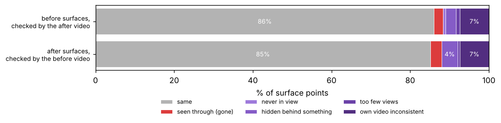

# What changed in the room?

`before_IMG_8815.MOV` → `after_IMG_8817.MOV` · 2026-10-16

**3 changes found**

1. **moved** · The black office chair moved 1.4 m, from the desk to between the bed and the wardrobe, and turned about 55°.
2. **removed** · The blue suitcase at the foot of the bed, against the wall, is gone: 48 frames of the after video look straight through the space it filled.
3. **added** · A black backpack (0.47 m tall) appeared at the foot of the bed. It stands on the floor, so it is a new obstacle.

## The room in 3D

Open `viewer.html` (the 3D viewer) in any browser, or run `deltanav view <out>`; add `--rerun` for the Rerun window.

| Before video only | After video only |
|---|---|
|  |  |

Videos: [`video/3d_model.mp4`](video/3d_model.mp4) · [`video/before_annotated.mp4`](video/before_annotated.mp4) · [`video/after_annotated.mp4`](video/after_annotated.mp4)

## Changes

Room frame: x and y along the walls, z up from the floor, metres; ± is 1 sigma.

### C1 · moved · office chair

The black office chair moved 1.4 m, from the desk to between the bed and the wardrobe, and turned about 55°.

| | |
|---|---|
| before | x 1.31, y 0.61, z 0.41 m ± 2 cm |
| after | x 2.65, y 0.86, z 0.43 m ± 3 cm |
| moved | 1.36 m ± 4 cm (Δx +1.34, Δy +0.25, Δz +0.02 m) |
| turned | +57.4° about z (confident; appearance (SIFT); 377 of 844 matches agree) |
| size | 0.46 × 0.43 × 0.69 m |
| orientation | long side at 0° → 90° (yaw, mod 180°) |
| relations | before: at desk, on floor, near desk (0.08 m), near wardrobe (0.47 m); after: between bed and wardrobe, on floor, near wardrobe (0.19 m), near bed (0.21 m) |
| evidence | old place: 59 after-video frames saw through it, 0 saw a surface; new place: 64 before-video frames saw through it, 0 saw a surface |
| humanoid robot | an obstacle for it; no route affected |
| compact robot | an obstacle for it; route to the nightstand: blocked |

### C2 · removed · suitcase

The blue suitcase at the foot of the bed, against the wall, is gone: 48 frames of the after video look straight through the space it filled.

| | |
|---|---|
| was at | x 1.43, y 2.25, z 0.41 m ± 2 cm |
| size | 0.38 × 0.17 × 0.61 m |
| orientation | long side at 180° (yaw, mod 180°) |
| relations | at foot of bed, against wall, on floor, near bed (0.15 m), near door (0.47 m) |
| evidence | 48 after-video frames saw straight through its place, 1 saw a surface there, 0 had it hidden |
| humanoid robot | no route affected |
| compact robot | no route affected |

### C3 · added · backpack

A black backpack (0.47 m tall) appeared at the foot of the bed. It stands on the floor, so it is a new obstacle.

| | |
|---|---|
| position | x 1.52, y 1.62, z 0.29 m ± 2 cm |
| size | 0.34 × 0.22 × 0.47 m |
| orientation | long side at 90° (yaw, mod 180°) |
| relations | at foot of bed, on floor, near bed (0.05 m), near radiator (0.80 m) |
| evidence | 23 before-video frames saw straight through its place, 1 saw a surface there, 15 had it hidden |
| humanoid robot | an obstacle for it; route to the wardrobe: unchanged (yesterday's route passes 0.22 m from it) |
| compact robot | an obstacle for it; no route affected |

## Floor plan

## For a robot

**humanoid (Ø 0.5 m, 1.8 m tall)**

- Yesterday's route to the wardrobe would pass within 0.22 m of the backpack, inside its 0.25 m radius.
- Floor it can reach from the door: 0.96 m² before, 1.10 m² now.

**compact robot (Ø 0.4 m, 0.5 m tall)**

- The nightstand can no longer be reached: the office chair is in the way.
- Yesterday's route to the nightstand would now run straight into the office chair.
- Floor it can reach from the door: 1.43 m² before, 1.53 m² now.

## Where to look next

| # | robot | stand at (x, y) | yaw | looks at | would check |
|---|---|---|---|---|---|
| 1 | humanoid | 1.12, 2.02 m | 255° | between the bed and the radiator | 0.54 m² |
| 2 | humanoid | 2.02, 0.82 m | 150° | between the desk and the window | 0.55 m² |
| 3 | humanoid | 1.43, 1.12 m | 195° | next to the window | 0.64 m² |
| 4 | compact | 1.12, 2.02 m | 255° | between the bed and the radiator | 0.48 m² |
| 5 | compact | 0.53, 1.12 m | 45° | at the foot of the bed | 0.23 m² |

## What could not be checked

## Naive diff vs the see-through test

